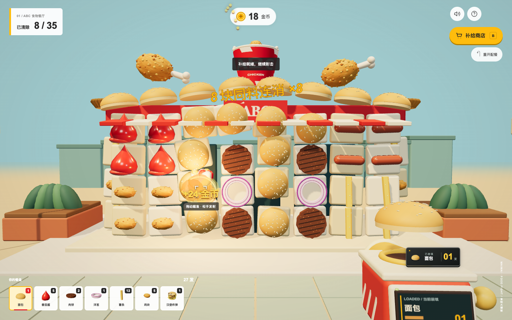

# 吃我一发麦麦

配一餐，装上膛。把面包、薯条和鸡块变成弹药，用第一人称视角玩食材连消。

**[打开在线试玩](https://zxzin.github.io/eat-my-maimai/)** · [单 HTML 文件](docs/index.html)

手机与电脑均可进入，下载单文件后也能离线游玩。

一款适合电脑和手机试玩的独立 3D 小游戏：玩家选择餐品配置弹药，在虚构的 ABC 食物餐厅中触发同类消除和食材组合，赚取金币、随时补给。麦当劳 MCP 为配装提供真实餐品数据。



## 怎么玩

1. **先配餐。** 开局 60 金币，选择餐品份数。汉堡可以拆成面包、肉饼等食材，也可以保留整件，成为范围爆破弹。
2. **瞄准食材。** 鼠标或触屏瞄准，松手发射；底部切换弹药，枪上显示当前装填物和剩余数量。
3. **连消赚金币。** 同类食材命中连消；番茄酱＋面包、肉饼＋面包、薯条＋番茄酱触发组合效果。消除一块奖励 3 金币，配方组合额外 3 金币，每块只奖励一次。
4. **随时加餐。** 打开补给商店购买新餐品，保留建筑损坏和现有弹药；商店打开时暂停，关闭后继续本局。

电脑快捷键：`Space` 发射、`1–8` 切弹、`B` 开关补给商店。金币仅在当前局内使用；游戏购买不产生真实餐饮订单。

## 本地试玩

需要 Node.js 20.19+ 或 22.12+，以及支持 WebGL 的浏览器。

```sh
npm install
npm run dev -- --port 5178
```

电脑打开 `http://127.0.0.1:5178/`。演示模式无需账号或真实消费，运行资源来自本地。

同一 Wi-Fi 下让手机试玩：

```sh
npm run dev:lan -- --port 5178
```

手机打开终端打印的 Network 地址。个人 MCP 授权在运行服务的电脑本机页面完成。

## 连接麦当劳 MCP

配餐页点击“连接麦当劳 MCP”，前往[官方平台](https://open.mcd.cn/mcp)登录、激活并取得个人 Token。仅在本机游戏输入框填写，提交后立即清空。Token 只保存在服务内存，不写入仓库、日志或浏览器存储。

连接实现包含初始化、工具发现、实时 schema 校验、只读工具白名单和官方营养目录 TOON 解析。2026-10-15 首次真实同步返回 158 项营养餐品，匹配当前可配装的巨无霸、麦辣鸡腿汉堡、五块麦乐鸡、中薯条、麦香鱼共 5 款。后续结果以官方实时返回为准。

**门店价格：已完成上海门店搜索、菜单参考价、可调整食材和本次配餐核价的真实调用验收。** 默认按“人民广场”查找上海门店，也可输入其他地标并切换门店。页面同时标明门店、到店自取和同步时间。金币成本、弹药份额和技能效果属于游戏设定；官方实时售价与供应以门店渠道为准。

接入实现和复现步骤见 [MCP_INTEGRATION.md](MCP_INTEGRATION.md)，配置示例见 [mcp-config.example.json](mcp-config.example.json)。

## 单 HTML 分享

单 HTML 版本将脚本、样式和程序化模型打进一个文件，用于低门槛试玩和分享。它可以携带明确标注时间的公共餐品快照，实时 MCP 连接继续由本机完整版本提供。

```sh
node scripts/build-single-html.mjs
```

产物路径：`release-single/吃我一发麦麦.html`，约 650 KB，脚本、样式和 Three.js 完全内联。已通过 `file://` 断网模式下桌面及 390×844、844×390、360×640 触屏模拟试玩。实体手机性能与小红书内置浏览器仍待实际验证。

分享版已内置 2026-10-15 21:41（北京时间）的上海黄浦华旭国际大厦餐厅公开快照，覆盖 5 款配装餐品。完整版本连接 MCP 并成功同步后，可刷新快照再打包：

```sh
npm run sync:public
npm run build:single
```

`sync:public` 只读取当前本机 MCP 连接，保存门店公开信息、匹配商品和公开参考价格；账号报价不进入分享文件。

## 开发与验证

```sh
npm test
npm run build
# 先启动 5178 开发服务；使用本机 Google Chrome
node scripts/shooter-check.mjs
node scripts/economy-check.mjs
# 先生成单 HTML 文件
node scripts/single-html-check.mjs
```

单测覆盖食材配对、弹药守恒、金币去重、购买原子性、MCP 协议和公开快照处理。浏览器检查使用鼠标与触摸事件，覆盖桌面及 390×844、844×390、360×640 布局、飞行暂停、补给继续与枪上数量。触屏模拟结果与实体手机体验分别记录。

需要准备公开源码副本时：

```sh
node scripts/package-github.mjs
```

脚本将明确允许的源码、文档和测试复制到 `release-github/`，生成文件清单；旧原型、私人配置、依赖目录与本地测试回执留在工作目录。脚本只准备本地副本，GitHub 发布和比赛报名另外执行。

## 来源与赛事

食品模型、发射器、建筑和效果使用本项目的程序化 3D 实现；品牌名称、标识及 MCP 服务归各自权利人。界面参考麦当劳白黄点餐视觉，ABC 为虚构餐厅。本项目由参赛者独立开发，属于非官方作品。

资料与参考：[数据和模型来源](docs/SOURCES.md)、[第三方许可](THIRD_PARTY_NOTICES.md)。

赛事：[麦当劳程序员创意开发大赛](https://github.com/M-China/mcd-developer-innovation-challenge)。参赛声明见 [CONTEST_DECLARATION.md](CONTEST_DECLARATION.md)。源码已按 MIT 许可公开，在线试玩由 GitHub Pages 提供；正式报名成功以主办方 Issue 回执为准。

## 开源许可

项目自创代码采用 [MIT](LICENSE) 许可。品牌名称、商标、MCP 服务和第三方内容保留各自权利，不因代码许可而转移；第三方依赖许可见 [THIRD_PARTY_NOTICES.md](THIRD_PARTY_NOTICES.md)。
